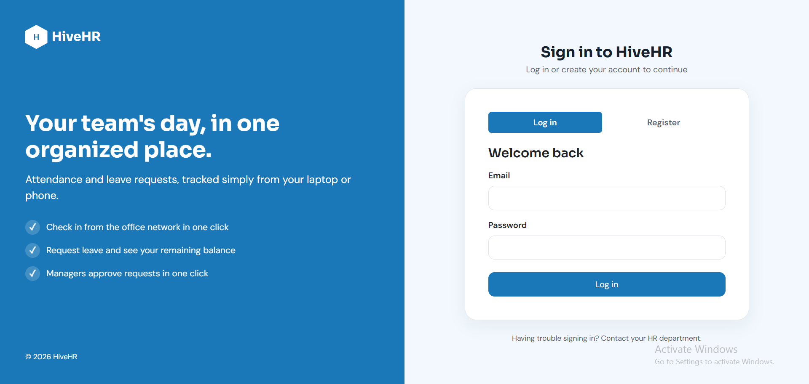
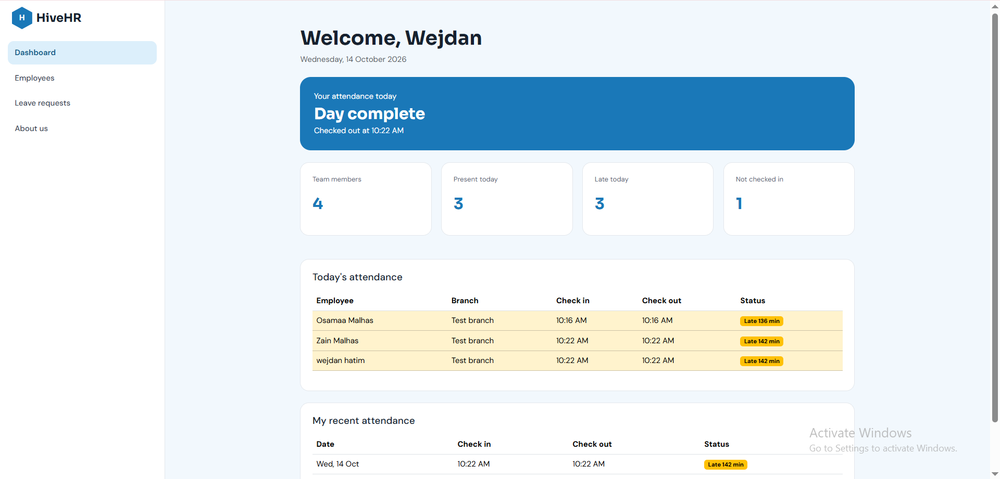
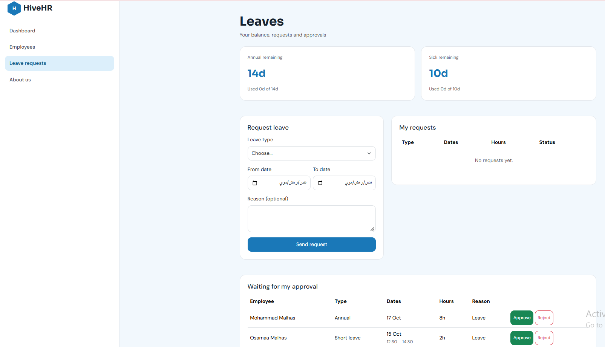
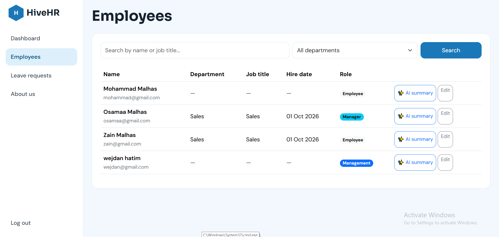
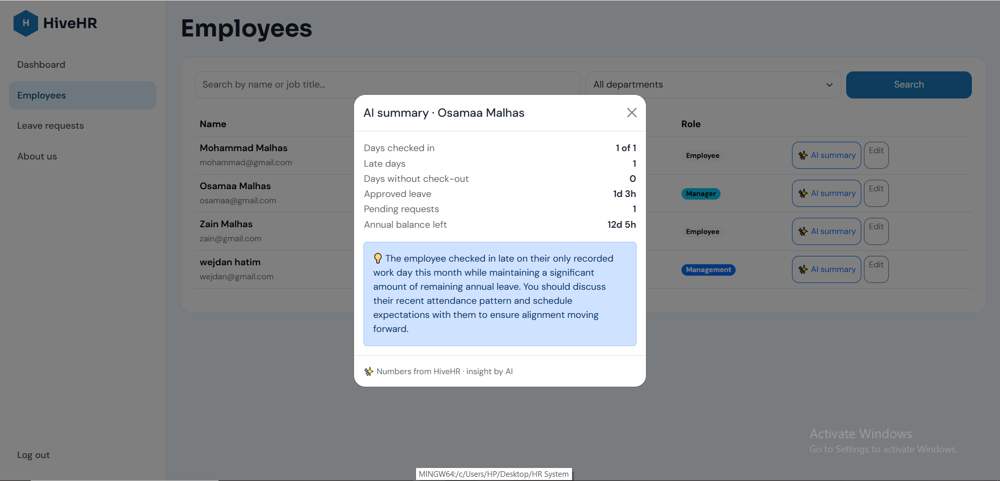
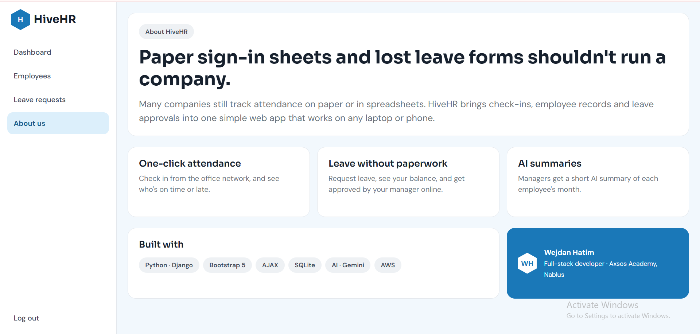
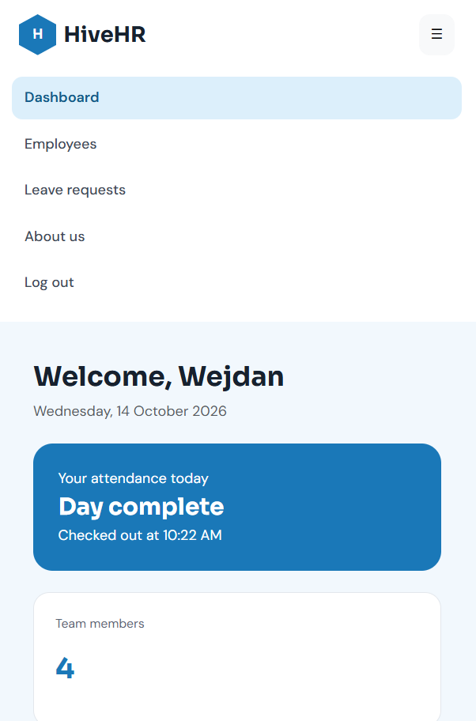

# 🐝 HiveHR

**Attendance and leave, in one organized place.**

HiveHR is a web-based HR system for small and medium companies. Employees check in from the office network, request leave and track their balance, while managers approve requests and get an AI summary of their team's month.

Built by **Wejdan Hatim** as a solo project for the **Axsos Academy Full-Stack Bootcamp** (October 2026).

🔗 **Live demo:** _coming soon_

---

## ✨ Features

### For employees
- **One-click check-in / check-out** with AJAX (no page reload)
- Check-in is allowed **only from a company branch network** (IP check)
- **Automatic late detection** (work starts 8:00 AM, 10 minutes grace)
- **Leave requests**: annual, sick, unpaid and short leave (in hours)
- **Live leave balance** in days and hours (8 hours = 1 day, Friday is off)
- **Notifications** on the dashboard when a request is approved or rejected

### For managers
- Team attendance for today: present, late and not checked in
- Approve or reject leave requests with AJAX
- **✨ AI monthly summary** for each employee, powered by Google Gemini

### For management
- Manage all employees: department, job title, hire date and roles
- Approve department managers' own leave requests

---

## 👥 Roles

| Role | Can do |
| **Employee** | Check in/out, request leave, see own balance |
| **Department manager** | Everything above + see their team and approve their team's leave |
| **Management** | Everything + edit employees and approve managers' leave |

---

## 🛠️ Tech stack

| Part | Tools |
| Backend | Python, Django, SQLite, bcrypt |
| Frontend | HTML, Bootstrap 5, JavaScript (AJAX / fetch) |
| AI | Google Gemini API (`google-genai` library) |
| Deploy | AWS |
| Planning | GitHub, Trello |

---

## 🗄️ Database

6 related tables: `Employee`, `Department`, `Branch`, `Attendance`, `LeaveType`, `LeaveRequest`.

- A department has many employees and one manager
- An employee has many attendance records and many leave requests
- A branch has many attendance records
- A leave type has many leave requests

---

## 🔒 Security

- Passwords are hashed with **bcrypt**
- Server-side **validation** on every form
- **CSRF protection** on all forms and AJAX requests
- Check-in time comes from the **server**, not the employee's device
- Role checks on every page and action
- Secrets (API keys) are kept in a `.env` file, never on GitHub
- The AI receives **only numbers**, never names or personal data

---

## 📸 Screenshots

### Login

### Dashboard (management view)

### Leave requests and approvals

### Employees

### ✨ AI monthly summary

### About

### Mobile view

---

## 👩‍💻 Author

**Wejdan Hatim**: Full-Stack Developer, Nablus, Palestine
